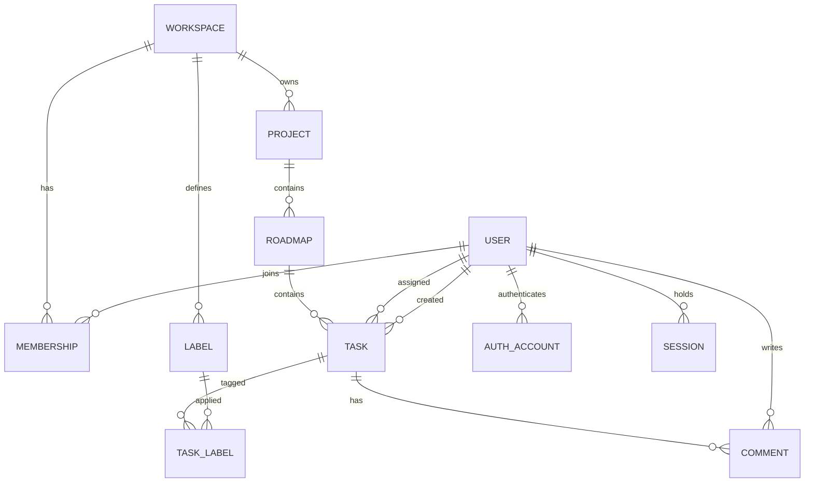

# Roadmap Studio データモデル

Issue #14 で確定する、画面・API・永続化が共有する正規データ構造。

- API 契約の正本は `openapi/openapi.yaml`（#15）。本書の TypeScript 風ブロックは説明用であり、`src/` に手書きの API 型を追加しない。
- 参照元の実装 Issue: #6（ボード）、#8（タイムライン）、#12（タスク作成）、#16（API・DB）、#13（Google 認証）。
- DB 製品・ホスティング・アクセスライブラリは #16 で選定する。本書はリレーショナルモデルとして定義し、製品に依存する記述は避ける。

## 1. フェーズ区分

| フェーズ | エンティティ |
|---|---|
| 1 | Workspace, User, Membership, Project, Roadmap, Task, Label, TaskLabel, Comment（テーブルのみ。投稿 UI は含めない） |
| 2 | AuthAccount, Session（#13）, Invitation（#11） |
| 3 | 通知設定、ワークスペース設定、権限変更の拡張（#5, #7, #10） |

フェーズ 1 は認証なしの開発用 seed（1 Workspace・1 Project・複数 User）で動作する。フェーズ 2/3 のテーブルはフェーズ 1 の完了条件に含めない。

## 2. ER 図

## 3. 共通規約

| 項目 | 決定 |
|---|---|
| ID | UUID v7 を小文字ハイフン付き文字列で保持する。ID はサーバーが採番し、クライアントは指定しない |
| 日付（`startDate`, `dueDate`） | 日付のみ。API・DB とも `YYYY-MM-DD`（OpenAPI `format: date`）。タイムゾーンを持たない |
| 監査日時（`createdAt`, `updatedAt` ほか） | UTC の RFC 3339 `date-time`（例 `2026-10-20T01:23:45Z`）。DB もタイムゾーン付き型または UTC 固定の ISO 文字列で保持する |
| 表示タイムゾーン | 閲覧者のブラウザのタイムゾーン。「今日」の判定と監査日時の表示だけに使い、保存値は変えない |
| 文字列 | 前後の空白を除去して保存する。空白のみは未入力として扱う |
| 更新競合 | 競合の対象テーブルは `version`（整数、作成時 1、更新ごとに +1）を持つ。更新要求は期待する `version` を送り、不一致なら `409 Conflict` を返す |

## 4. 型の分離

| 種別 | 内容 | 例（Task） |
|---|---|---|
| 永続化モデル | DB の行。`workspaceId`, `version`, 監査列を含む | 第 5 章の表 |
| API レスポンス | 永続化モデルから `labelIds`, `commentCount` を付与したもの。`progressPercent` は含めない | `Task` |
| 作成入力 | クライアントが決められる項目のみ。ID・作成者・監査日時・`version`・`sortOrder` は含まない | `TaskCreate` |
| 部分更新入力 | 変更項目と期待 `version` のみ。未指定は据え置き、`null` は未設定化 | `TaskUpdate` |

`TaskCreate` の初期値は `status = todo`、`priority = medium`。列の追加操作から開いた場合は、その列の `status` を初期値にする。`sortOrder` は作成時にサーバーが当該列の末尾へ採番する。

## 5. エンティティ定義

「必須」は DB の NOT NULL、「削除時」は参照先が削除されたときの外部キーの動作を表す。

### 5.1 Workspace

| フィールド | 型 | 必須 | 備考 |
|---|---|---|---|
| id | uuid | ○ | PK |
| name | string(1..100) | ○ | |
| createdAt / updatedAt | date-time | ○ | |
| version | int | ○ | |

### 5.2 User

| フィールド | 型 | 必須 | 備考 |
|---|---|---|---|
| id | uuid | ○ | PK。内部 ID。認証主体とは独立 |
| name | string(1..100) | ○ | |
| email | string | ○ | 連絡先・表示用。一意制約は持たない。認証主体の同定には使わない |
| avatarUrl | string(URL) | － | |
| deletedAt | date-time | － | 退会時に設定（論理削除） |
| createdAt / updatedAt | date-time | ○ | |

既存 OpenAPI の `User.id` は `integer` のため、`string(uuid)` への変更を #15 で反映する。

### 5.3 AuthAccount（フェーズ 2）

| フィールド | 型 | 必須 | 削除時 |
|---|---|---|---|
| id | uuid | ○ | |
| userId | uuid | ○ | User 物理削除で CASCADE |
| provider | enum(`google`) | ○ | |
| providerAccountId | string | ○ | Google の安定した識別子（`sub`） |
| createdAt | date-time | ○ | |

- `(provider, providerAccountId)` に一意制約を置く。同一主体の並行ログインでも User は 1 件だけ作成する。
- メールアドレスが変わっても `sub` で既存 User に対応づけ、別 User を作らない。メールだけで既存 User に自動で結びつけない。
- Google のパスワードは保持しない。アクセストークン・リフレッシュトークンは、必要になるまで保存しない。保存する場合は暗号化し、ログ・URL・レスポンスへ出さない。

### 5.4 Session（フェーズ 2）

| フィールド | 型 | 必須 | 削除時 |
|---|---|---|---|
| id | uuid | ○ | |
| userId | uuid | ○ | User 物理削除で CASCADE |
| tokenHash | string | ○ | セッショントークンのハッシュ。平文は保存しない。一意 |
| expiresAt | date-time | ○ | |
| createdAt | date-time | ○ | |

セッションはサーバー側 DB に保存し、Cookie（HttpOnly, Secure, SameSite=Lax）にはトークンのみを置く。失効は行の削除で即時に行える。認証ライブラリが追加の列を要求する場合は #13 で追加する。

### 5.5 Membership

| フィールド | 型 | 必須 | 削除時 |
|---|---|---|---|
| id | uuid | ○ | |
| workspaceId | uuid | ○ | Workspace 削除で CASCADE |
| userId | uuid | ○ | User 物理削除で CASCADE |
| role | enum | ○ | 第 6 章 |
| createdAt / updatedAt | date-time | ○ | |

`(workspaceId, userId)` に一意制約を置き、重複所属を禁止する。`(workspaceId, userId)` は Task の外部キーの参照先にもなる。

### 5.6 Project

| フィールド | 型 | 必須 | 削除時 |
|---|---|---|---|
| id | uuid | ○ | |
| workspaceId | uuid | ○ | Workspace 削除で CASCADE |
| name | string(1..100) | ○ | |
| archivedAt | date-time | － | アーカイブ中は一覧から除外 |
| createdAt / updatedAt / version | | ○ | |

### 5.7 Roadmap

| フィールド | 型 | 必須 | 削除時 |
|---|---|---|---|
| id | uuid | ○ | |
| projectId | uuid | ○ | Project 削除で CASCADE |
| workspaceId | uuid | ○ | 非正規化。`(projectId, workspaceId)` が Project と一致することを複合外部キーで保証 |
| name | string(1..100) | ○ | |
| description | string(0..2000) | － | |
| archivedAt | date-time | － | |
| createdBy | uuid | ○ | User。User は論理削除のため参照は残る（RESTRICT） |
| createdAt / updatedAt / version | | ○ | |

パンくずは Workspace > Project > Roadmap > 画面（タイムライン / ボード）の順で表示する。画面 URL は `roadmapId` を含み、画面を切り替えても同じ Roadmap を保つ。

### 5.8 Task

| フィールド | 型 | 必須 | 削除時 / 制約 |
|---|---|---|---|
| id | uuid | ○ | |
| roadmapId | uuid | ○ | Roadmap 削除で CASCADE |
| workspaceId | uuid | ○ | 非正規化。Roadmap と一致することを複合外部キーで保証 |
| title | string(1..200) | ○ | |
| description | string(0..10000) | － | |
| status | enum | ○ | 第 7 章。既定 `todo` |
| priority | enum | ○ | 第 7 章。既定 `medium` |
| assigneeId | uuid | － | `(workspaceId, assigneeId)` → Membership。担当者の Membership 削除時は SET NULL |
| startDate | date | － | |
| dueDate | date | － | |
| sortOrder | string | ○ | 第 8 章 |
| createdBy | uuid | ○ | User（RESTRICT。論理削除のため残る） |
| createdAt / updatedAt | date-time | ○ | |
| version | int | ○ | |

- 検査制約: `startDate IS NULL OR dueDate IS NULL OR startDate <= dueDate`。
- `labelIds` は TaskLabel から、`commentCount` は Comment の件数から API 層で付与する。Task テーブルに `progressPercent`・`commentCount` の列は置かない。
- #12 の暫定案から次を変更する: `sortOrder` を `number` から `string` に変更する。`workspaceId`・`version` を追加する（API レスポンスでは `version` を公開する）。

### 5.9 Label

| フィールド | 型 | 必須 | 削除時 |
|---|---|---|---|
| id | uuid | ○ | |
| workspaceId | uuid | ○ | Workspace 削除で CASCADE。ラベルの所属範囲は Workspace |
| name | string(1..50) | ○ | `(workspaceId, name)` に一意制約 |
| color | string(`#RRGGBB`) | ○ | |
| createdAt / updatedAt | date-time | ○ | |

### 5.10 TaskLabel

| フィールド | 型 | 削除時 |
|---|---|---|
| taskId | uuid | Task 削除で CASCADE |
| labelId | uuid | Label 削除で CASCADE（Task からは外れる） |
| workspaceId | uuid | Task・Label の `workspaceId` と一致することを複合外部キーで保証 |

PK は `(taskId, labelId)`。別 Workspace のラベルは付与できない。

### 5.11 Comment

| フィールド | 型 | 必須 | 削除時 |
|---|---|---|---|
| id | uuid | ○ | |
| taskId | uuid | ○ | Task 削除で CASCADE |
| authorId | uuid | ○ | User（RESTRICT。論理削除のため残る） |
| body | string(1..5000) | ○ | |
| createdAt / updatedAt | date-time | ○ | |

コメント数は `COUNT(*) WHERE taskId = ?` から算出する。コメントがなければ 0。保存列は持たない。

## 6. 共有境界と権限

共有の単位は Workspace。Workspace に属する Project / Roadmap / Task / Label / Comment は、Membership を持つ User だけが参照できる。非メンバーには存在自体を隠すため `404` を返す。

| role | 表示名 | できること |
|---|---|---|
| owner | オーナー | すべて。Workspace 削除、メンバーと role の管理 |
| admin | 管理者 | メンバー招待・削除（owner を除く）、Project / Roadmap / Label の管理、Task の編集 |
| member | メンバー | Roadmap・Task・Comment の作成と編集。Label の付与 |

- Workspace には owner を 1 人以上保つ。最後の owner の削除・降格は拒否する。
- 担当者は同じ Workspace の Membership を持つ User に限る。
- フェーズ 1 の seed ユーザーは全員 `member` とし、開発用ユーザーは `owner` とする。権限の強制はフェーズ 2 で認証と同時に有効にする。

## 7. 列挙値と表示名

| 項目 | 値 | 表示名 | 進捗率 |
|---|---|---|---|
| status | `todo` | 未着手 | 0% |
| status | `in_progress` | 進行中 | 33% |
| status | `review` | レビュー | 67% |
| status | `done` | 完了 | 100% |
| priority | `low` | 低 | － |
| priority | `medium` | 中 | － |
| priority | `high` | 高 | － |
| priority | `urgent` | 緊急 | － |

ボードの列順は `todo`, `in_progress`, `review`, `done` の固定。

## 8. 派生値のルール

### 進捗率

保存しない。`status` から共通関数 `taskProgressPercent(status)` で算出し、ボード・タイムライン・マイタスクのすべてがこれを使う。値は第 7 章の表（0 / 33 / 67 / 100）で確定とする。関数は #15 の生成型 `Task['status']` を引数にとるため、実装は #6 または #12 で `src/` に置く。

### Task の status 変更

ボード・タイムライン・マイタスクは同じ `PATCH` 更新（`status`, `sortOrder`, `version`）を通じて変更する。画面ごとの status 変換は持たない。更新後は Roadmap のタスク一覧と、該当 Task の詳細のクエリを無効化して再取得する。

### 列内の表示順

- `sortOrder` は Roadmap と status の組ごとに独立した、辞書順で比較する文字列（fractional indexing, base62）。
- 並べ替えと列間移動は、移動先の前後 Task の `sortOrder` の間に入る新しい値を、サーバーが計算して保存する（クライアントは直前・直後の Task ID を送る）。
- 表示は `ORDER BY sortOrder ASC, id ASC`。同値になった場合は `id` で解消する。キーの間隔が尽きた場合は、その列だけを再採番する。
- status の変更と `sortOrder` の更新は 1 回の更新で原子的に行う。

### 日付の扱い（タイムライン）

| startDate | dueDate | 表示 |
|---|---|---|
| あり | あり | 開始日〜期限の期間バー（同日なら 1 日分） |
| なし | あり | 期限日にマーカー |
| あり | なし | 開始日にマーカー |
| なし | なし | 「日付未設定」の領域に一覧表示。バーは出さない |

表示期間外のタスクは、期間外であることが分かる表示にし、行は残す。

## 9. 削除時の扱い

| 対象 | 方針 |
|---|---|
| User | 物理削除しない。`deletedAt` を設定し、`name` を匿名化、`email`・`avatarUrl` を消去する。Membership と AuthAccount と Session は削除する。担当していた Task は `assigneeId = NULL`。作成者・コメント投稿者の参照は残る |
| Workspace | 配下の Project / Roadmap / Task / Label / Comment / Membership を CASCADE で削除する。フェーズ 1 では削除 API を提供しない |
| Project / Roadmap | フェーズ 1 では `archivedAt` によるアーカイブのみ。物理削除時は配下の Task を CASCADE で削除する |
| Membership | 削除時、その Workspace 内で担当していた Task の `assigneeId` を NULL にする |
| Label | TaskLabel を CASCADE で削除する。Task は残る |
| Task | TaskLabel と Comment を CASCADE で削除する |

## 10. 索引

| 用途 | 索引 |
|---|---|
| ボード・タイムラインのタスク一覧 | `task(roadmapId, status, sortOrder, id)` |
| 日付での絞り込み・並び | `task(roadmapId, dueDate, id)` |
| マイタスク（フェーズ 2） | `task(workspaceId, assigneeId, status, dueDate, id)` |
| コメント件数・一覧 | `comment(taskId, createdAt, id)` |
| ラベルによる絞り込み | `task_label(labelId, taskId)` |
| 所属一覧 | `membership(userId)`、`membership(workspaceId, userId)` は一意 |
| 認証（フェーズ 2） | `auth_account(provider, providerAccountId)` は一意、`session(tokenHash)` は一意 |

一覧 API はキーセット方式のカーソルページングとする。並びのキーに `id` を含めて同順位を解消する。1 回の取得件数は既定 100、上限 200 とする。

## 11. 永続化とマイグレーション方針

- リレーショナルデータベースを使い、スキーマは SQL マイグレーションファイルとしてリポジトリで管理する。DB 製品とマイグレーション実行ツールは #16 で選定する。
- マイグレーションは前進のみとする。適用済みのファイルは編集せず、変更は新しいファイルで行う。
- 破壊的変更（列の削除・型変更）は、列の追加 → コードの移行 → 旧列の削除、の複数リリースに分ける。
- 開発用 seed はマイグレーションとは別に管理し、本番では実行しない。
- スキーマ変更時は、本書と `openapi/openapi.yaml` を同じ PR で更新し、`pnpm api:generate` で生成物を再生成する。

## 12. 決定事項

- 共有単位は Workspace。ラベルの所属は Workspace。
- 進捗率とコメント数は保存せず、`status` とコメントから算出する。進捗は 0 / 33 / 67 / 100 で確定。
- ID は UUID v7 文字列。日付は `YYYY-MM-DD`、監査日時は UTC `date-time`。
- 並び順は文字列の `sortOrder`（fractional indexing）、同値は `id` で解消。
- 更新競合は `version` による楽観ロックで検出し、`409` を返す。
- 認証主体は Google の `sub` で内部 User に対応づける。セッションはサーバー側 DB に保存する。
- User は論理削除。Workspace 配下は CASCADE。

## 13. 未決事項

| 項目 | 決定する場所 |
|---|---|
| DB 製品、ホスティング、アクセスライブラリ、マイグレーション実行ツール | #16 |
| 認証ライブラリ、セッション有効期間、Cookie 名、コールバック URL | #13 |
| `User.id` の `integer` から `uuid` への変更、`Task.sortOrder` の `string` 化、`version` の公開 | #15 |
| 招待（Invitation）のデータ構造 | #11 |
| `admin` の細かな権限、メンバー管理画面の操作範囲 | #10 |
| ボードで 1 列に大量のタスクがある場合の取得方式（列ごとのページング） | #6 |
| タイムライン上で日付をドラッグ変更する操作の採否 | #8 |
